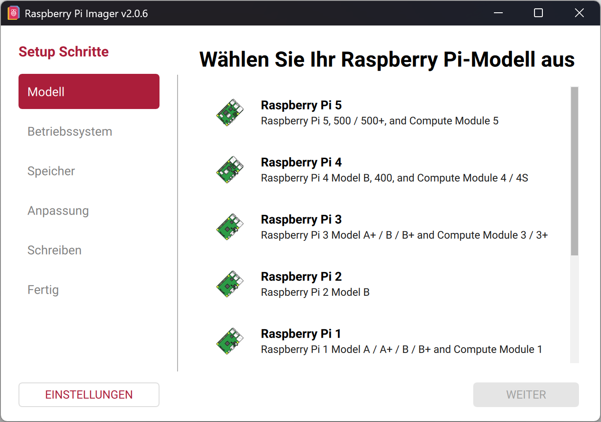
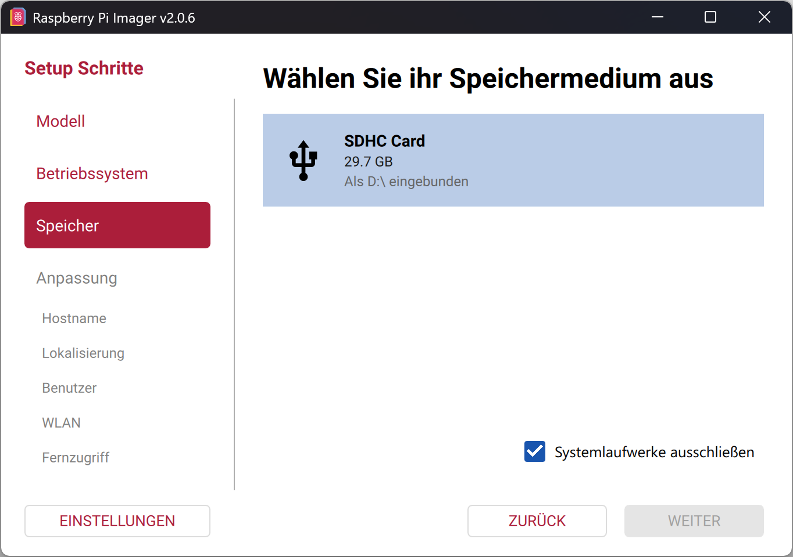
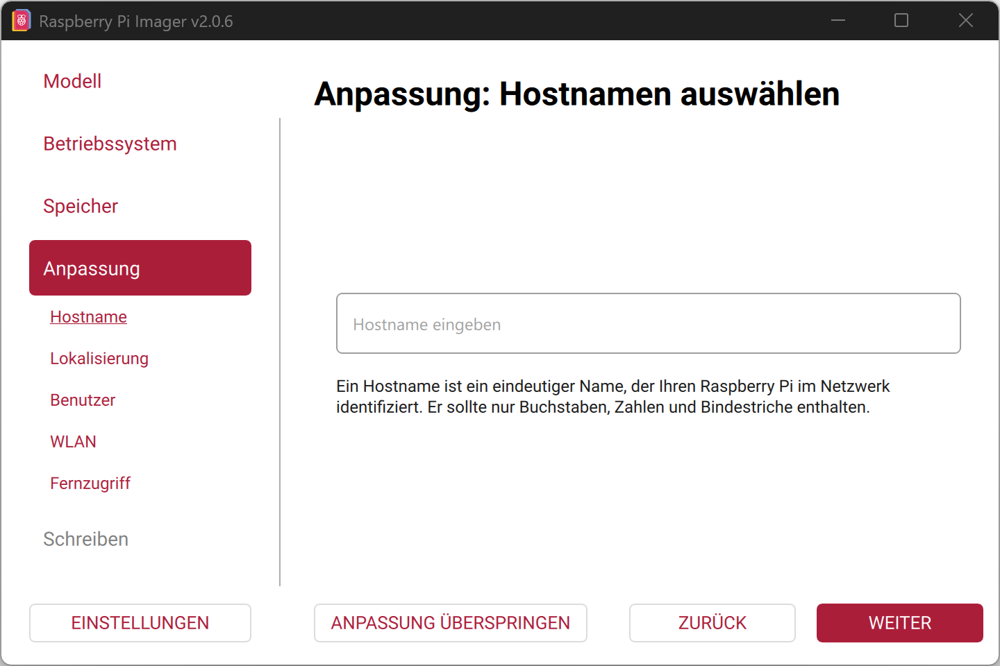
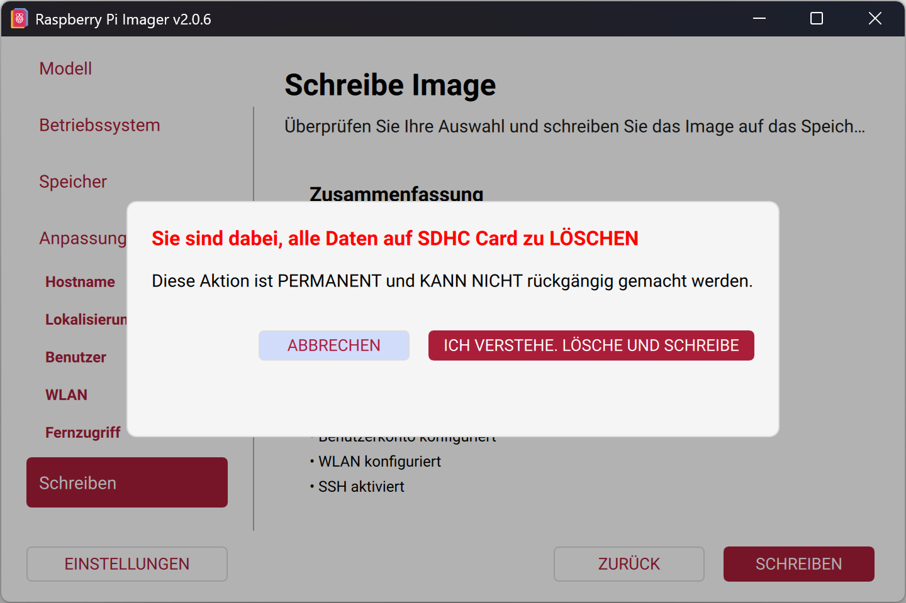

Smartfinch gibt es als fertiges SD-Image: Raspberry Pi OS mit Smartfinch und dem BirdNET-Modell, bereits installiert.
Du schreibst es auf die microSD-Karte, steckst die Karte in den Pi, und die Station startet beim ersten Einschalten den Hotspot mit dem Einrichtungsassistenten.
Der Pi selbst braucht dafür kein Internet.

## Voraussetzungen

Du brauchst einen Computer mit Internetzugang, eine microSD-Karte (siehe [Benötigte Materialien](../components/)) und einen Kartenleser.

## Image herunterladen

<Steps>

1. Öffne die Seite mit der neuesten Version von Smartfinch Pi auf GitHub.

   <LinkCard
     title="Smartfinch Pi – neueste Version"
     description="Download-Seite mit dem SD-Image und dem Installationsbefehl."
     href="https://github.com/rajsei/smartfinch-pi/releases/latest"
     isExternal
   />

2. Scrolle zum Abschnitt `Assets` und lade die Datei herunter, deren Name mit `-arm64.img.xz` endet, zum Beispiel `smartfinch-v0.1.0-arm64.img.xz`.
   Der Download kann einige Minuten dauern. Du musst die Datei nicht entpacken, der Raspberry Pi Imager liest sie direkt.

</Steps>

## Image auf die SD-Karte schreiben

<Steps>

1. Verbinde die microSD-Karte mit deinem Computer.
   Alle Daten auf der Karte werden gleich gelöscht. Sichere sie vorher, falls du sie noch brauchst.

2. Lade den Raspberry Pi Imager unter [raspberrypi.com/software](https://www.raspberrypi.com/software/) herunter, installiere ihn und öffne ihn.

3. Wähle das Modell deines Raspberry Pi aus.
   

4. Beim Betriebssystem scrollst du ganz nach unten und wählst `Eigenes Image`.
   Wähle dann die heruntergeladene Datei `smartfinch-…-arm64.img.xz` aus.

5. Wähle die SD-Karte aus.
   Prüfe den Namen und die Größe genau, denn im nächsten Schritt wird alles auf diesem Laufwerk gelöscht.
   

6. Danach bietet dir der Imager Anpassungen an (Hostname, Benutzer, WLAN, SSH).
   Für Smartfinch brauchst du keine davon und kannst `Anpassung überspringen` wählen.
   Die Station heißt dann `smartfinch-pi` und öffnet beim ersten Start ihren eigenen Hotspot.
   

   Wann sich die Anpassungen trotzdem lohnen, steht [weiter unten](#optionale-anpassungen-im-imager).

7. Starte das Schreiben und bestätige mit `Ich verstehe. Lösche und schreibe`.
   

8. Der Imager schreibt und prüft nun das Image. Das dauert je nach Karte etwa 5 bis 15 Minuten.
   Sobald die Meldung `Schreibvorgang beendet!` erscheint, kannst du die Karte entnehmen.

</Steps>

Weiter geht es mit der [Ersteinrichtung](../first-setup/).

## Optionale Anpassungen im Imager

Die Anpassungen im Imager sind freiwillig. Diese Fälle sind die wichtigsten:

- **Benutzer und SSH:** Lege einen Benutzer an und aktiviere SSH, wenn du Smartfinch später aktualisieren möchtest.
  Updates installierst du derzeit mit einem Befehl über die Konsole (siehe [Installation per Befehl](../install-script/#smartfinch-aktualisieren)); eine Update-Funktion in der Weboberfläche gibt es noch nicht.
  Ohne SSH bleibt der Pi auf der Version, die du gerade schreibst.
- **Hostname:** Betreibst du mehrere Stationen im selben Netzwerk, gib jeder einen eigenen Namen. Smartfinch übernimmt ihn als Gerätenamen.
  Du kannst den Namen aber auch später im Einrichtungsassistenten festlegen.
- **WLAN:** Trägst du hier ein WLAN ein, verbindet sich der Pi direkt damit und öffnet keinen Hotspot, solange das WLAN erreichbar ist.
  Den Einrichtungsassistenten öffnest du dann von einem Gerät im selben WLAN aus.
- **Land:** Das Image ist für den WLAN-Betrieb in Deutschland voreingestellt. Betreibst du die Station in einem anderen Land, gib in der Anpassung dein Land an.
