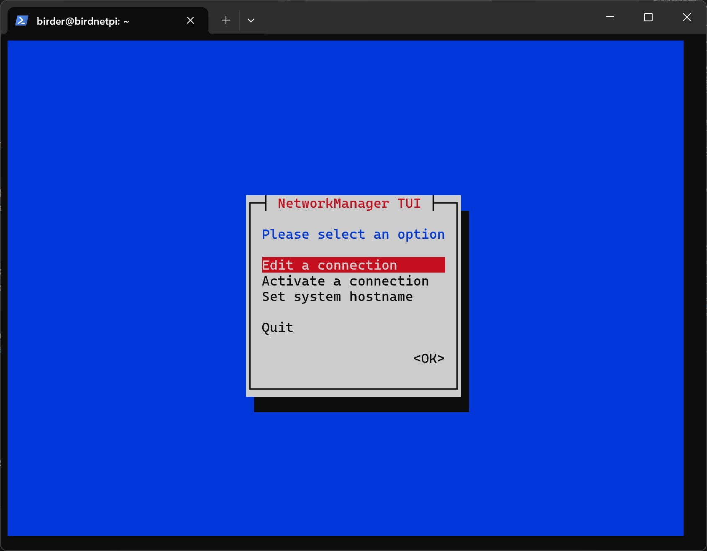
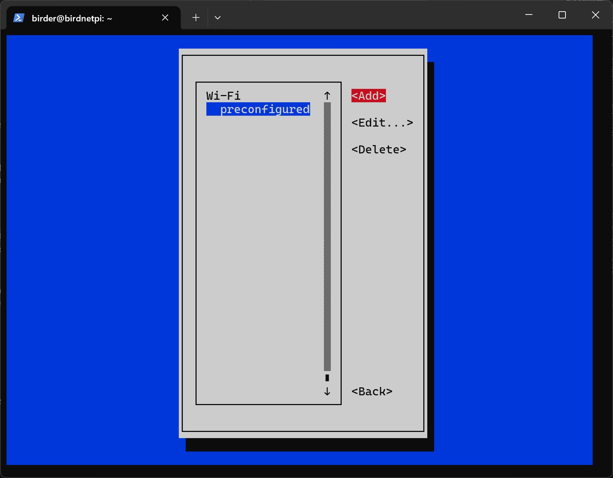
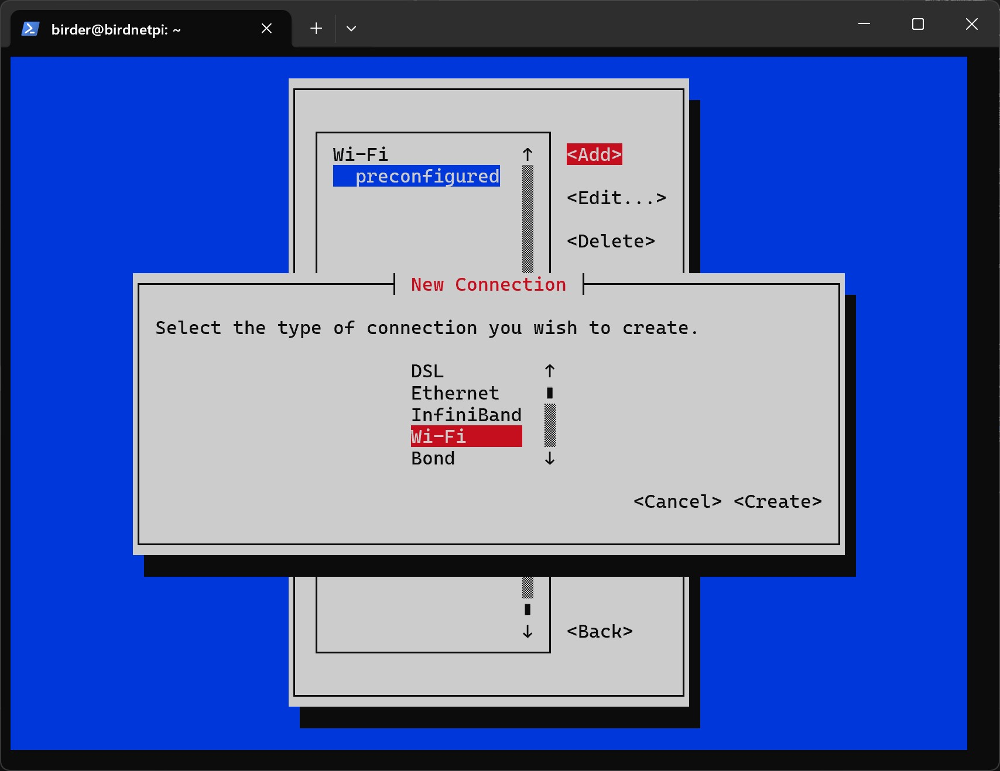
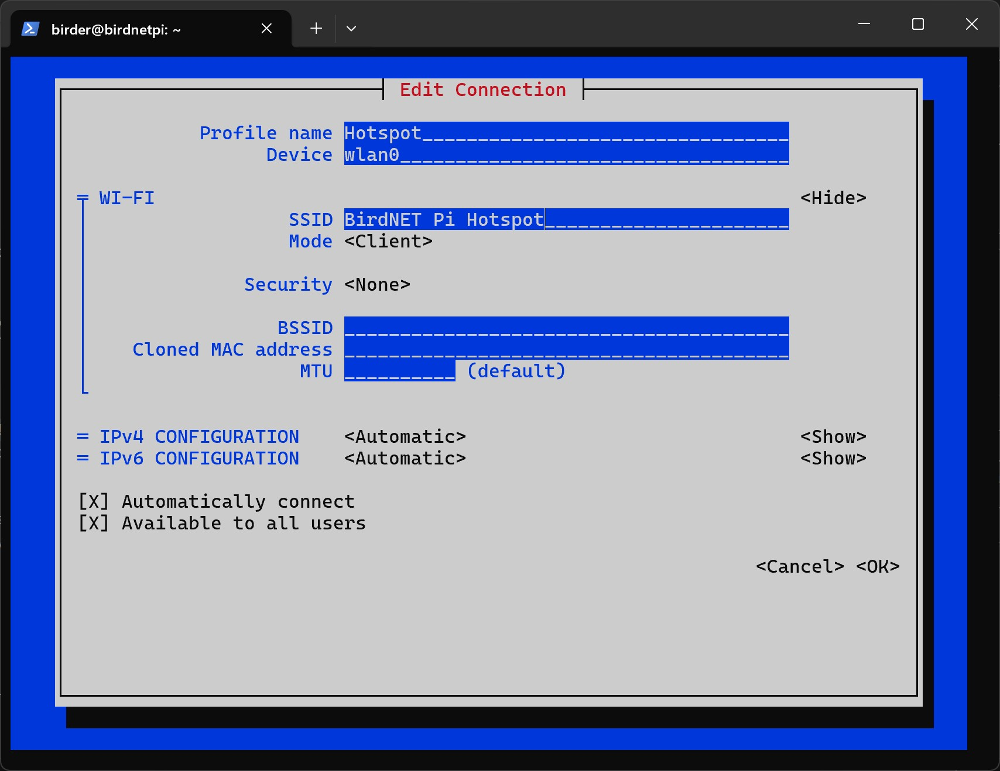
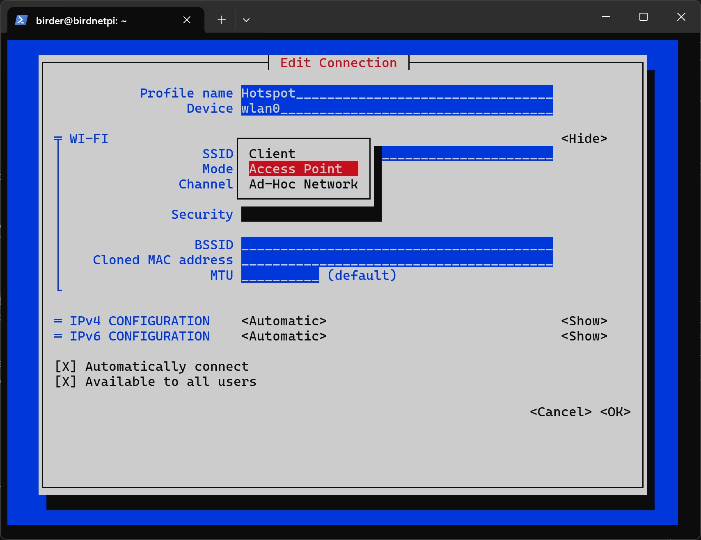
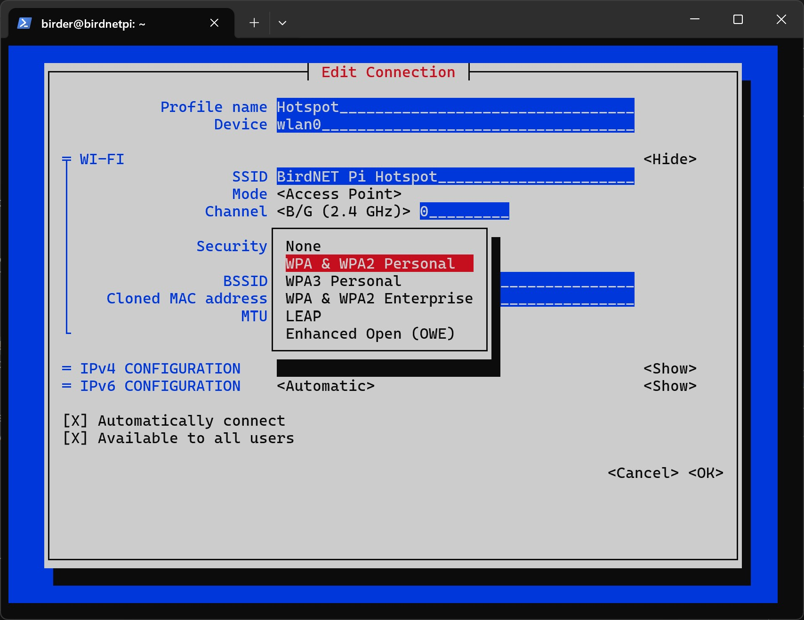
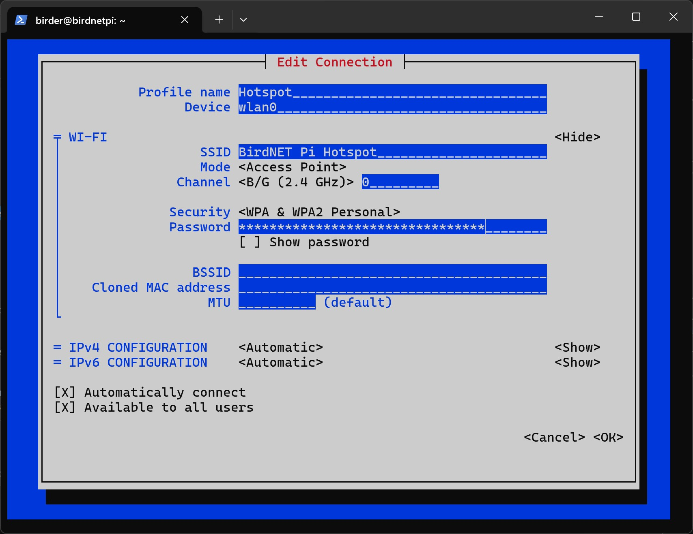
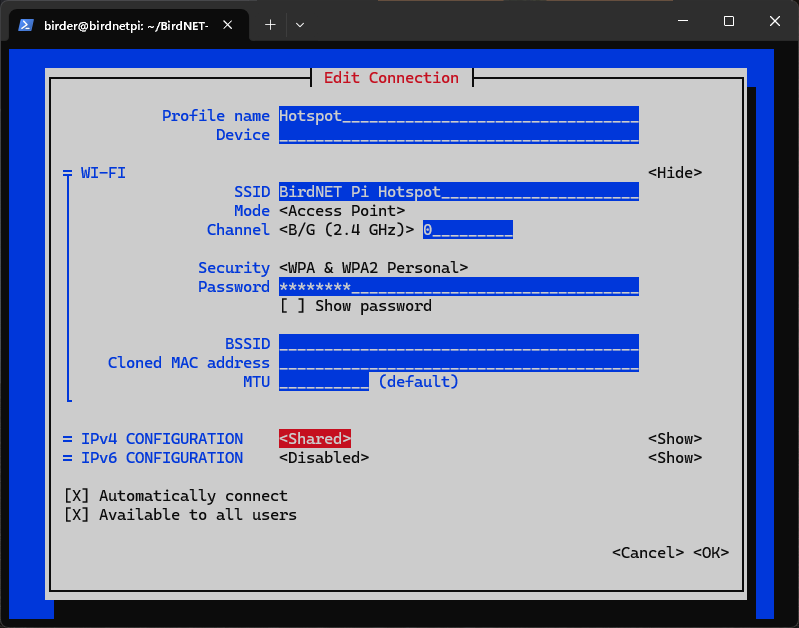
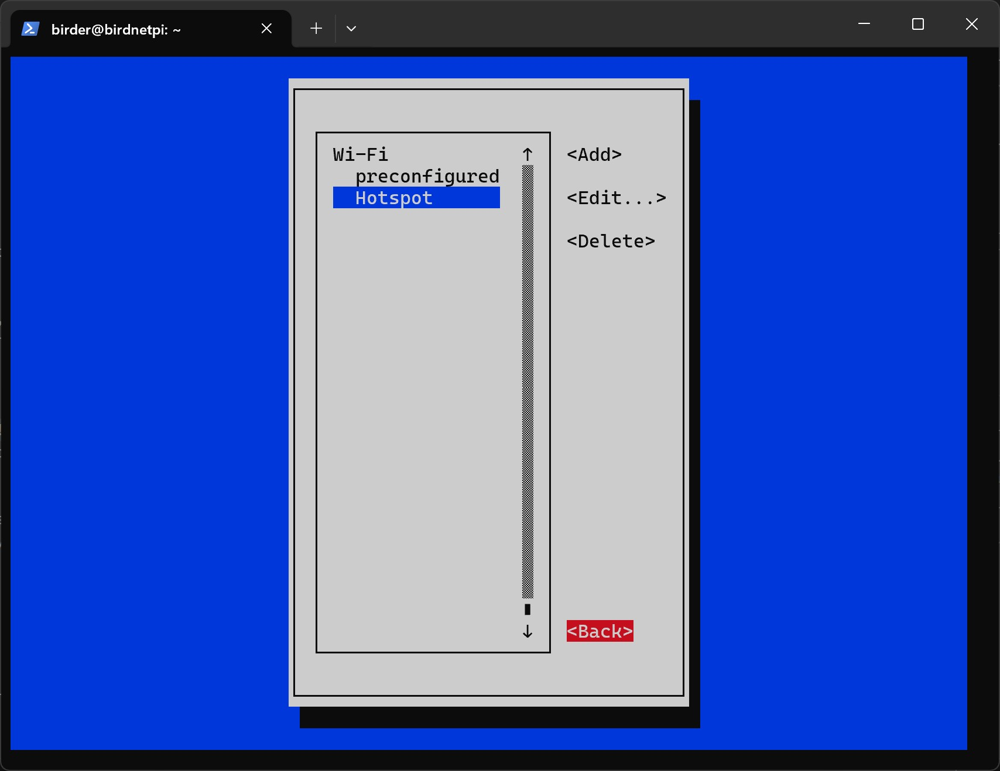
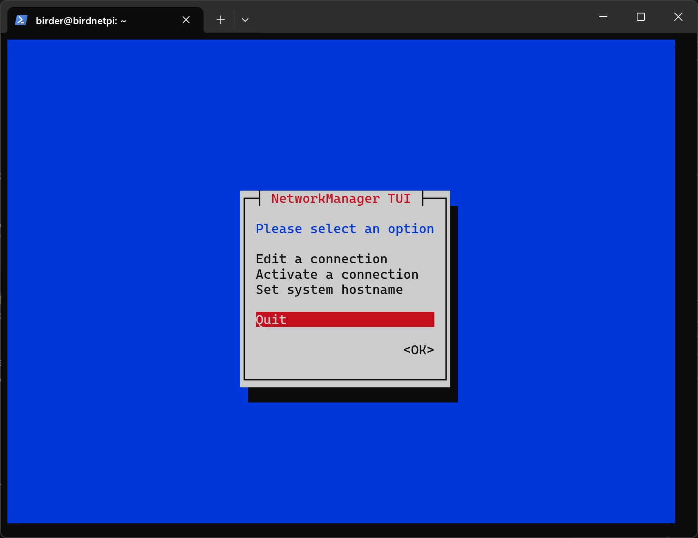

## When should I do this?

If your BirdNET-Pi will only be placed within range of your <Term id="network">Wi-Fi</Term>, you can skip the following steps.
In this part we'll configure settings so that, if your BirdNET-Pi is outside your Wi-Fi, it works as a hotspot and broadcasts its own Wi-Fi network (this one has no internet access). That way you can, for example, connect to the BirdNET-Pi from your phone over Wi-Fi and access its data.
Here you can also, for instance, add further Wi-Fi networks or change the Wi-Fi credentials you already entered during the Raspberry Pi OS setup.

## Instructions

<Steps>

0. Connect via SSH.
1. Now we edit the Wi-Fi and hotspot settings. To do this, we first have to open the Network Manager:

```
sudo nmtui
```



2. In the Network Manager you can move the selected element with the <kbd class="kbd">arrow keys</kbd> and confirm with <kbd class="kbd">Enter</kbd>.

3. Choose `Edit a connection`.


4. Choose `Add`.



5. Choose `Wi-Fi` as the connection type.



6. Choose `Create`.


7. Now the details of your network need to be added.

   - `Profile Name` is only for identification; you can enter any name here. But make sure that in the following commands you replace "Hotspot" with the name you chose.

   - `Device` is wlan0.

   - `SSID` is the name of the Wi-Fi network that will be created; you can choose this freely too, but remember it!



8. For `Mode`, select `Access Point`.



9. For `Channel`, select `B/G (2.4 GHz)`.


10. For `Security`, choose `WPA & WPA2 Personal`.



11. For `Password`, now enter the password for the hotspot. Remember it!



12. Configure the **IP settings** as follows:

- IPv4 Configuration: `Shared`
- IPv6 Configuration: `Disabled`



13. Now we can close the program. To do so, go to `OK` at the bottom.
14. Go to `Back`.



15. Go to `Quit`.



16. Now we set the connection priorities of the Wi-Fi and hotspot connections.
    This makes the Raspberry Pi try to connect to the known Wi-Fi first.
    Only if no connection is possible does it automatically create its own hotspot,
    so that a connection to the device can still be established.
    First we have to navigate to the right folder using the `cd` command.

```
cd /etc/NetworkManager/system-connections
```

<Code
  lang="plaintext"
  title="Terminal"
  class="terminal-code"
  code="birder@birdnetpi:~ $ cd /etc/NetworkManager/system-connections
  birder@birdnetpi:/etc/NetworkManager/system-connections $"
/>

17. Now let's first open the file for the hotspot connection.

```
sudo nano Hotspot.nmconnection
```

<Code
  lang="plaintext"
  title="Terminal"
  class="terminal-code"
  code="  GNU nano 7.2                     Hotspot.nmconnection                               [connection]
id=Hotspot
uuid=4cc09b40-6ef0-4caf-bbf6-600fe2121122
type=wifi
interface-name=wlan0

[wifi]
band=bg
mode=ap
ssid=BirdNET Pi Hotspot

[wifi-security]
key-mgmt=wpa-psk
psk=Your hotspot password goes here

[ipv4]
method=auto

[ipv6]
addr-gen-mode=default
method=auto

[proxy]

                                  [ Read 23 lines ]

^G Help ^O Write Out ^W Where Is ^K Cut ^T Execute ^C Location
^X Exit ^R Read File ^\ Replace ^U Paste ^J Justify ^/ Go To Line"
/>

18. Add the following code snippet to the first part of the file.
    The entry `autoconnect=true` enables automatic connecting.
    The value `autoconnect-priority=0` sets the priority of the network.
    The higher the number, the more this network is preferred when connecting automatically.

```
autoconnect=true
autoconnect-priority=0
```

<Code
  lang="plaintext"
  title="Terminal"
  class="terminal-code"
  highlight={[7,8]}
  code="  GNU nano 7.2                     Hotspot.nmconnection *                             [connection]
id=Hotspot
uuid=4cc09b40-6ef0-4caf-bbf6-600fe2121122
type=wifi
interface-name=wlan0

autoconnect=true
autoconnect-priority=0

[wifi]
band=bg
mode=ap
ssid=BirdNET Pi Hotspot

[wifi-security]
key-mgmt=wpa-psk
psk=Show your parents the bird!

[ipv4]
method=shared

[ipv6]
addr-gen-mode=default
method=disabled

[proxy]

^G Help ^O Write Out ^W Where Is ^K Cut ^T Execute ^C Location
^X Exit ^R Read File ^\ Replace ^U Paste ^J Justify ^/ Go To Line"
/>

19. Press <kbd class="kbd">Ctrl+X</kbd>, then <kbd class="kbd">y</kbd>, and finally <kbd class="kbd">Enter</kbd> to save the file.
20. Now let's open the file for the Wi-Fi connection.

```
sudo nano preconfigured.nmconnection
```

<Code
  lang="plaintext"
  title="Terminal"
  class="terminal-code"
  code='  GNU nano 7.2              preconfigured.nmconnection                  [connection]
id=preconfigured
uuid=fh6c02n6-5th7-4911-9g5c-d356zh245
type=wifi
timestamp=27604593

[wifi]
hidden=true
mode=infrastructure
ssid=Your_WiFi_Name

[wifi-security]
key-mgmt=wpa-psk
psk=4c9ed4tg67fd672c6896d1ec9e1g885a61f4th322be

[ipv4]
method=auto

[ipv6]
addr-gen-mode=default
method=auto

[proxy]

                                  [ Read 23 lines ]

^G Help ^O Write Out ^W Where Is ^K Cut ^T Execute ^C Location
^X Exit ^R Read File ^\ Replace ^U Paste ^J Justify ^/ Go To Line'
/>

21. Add the following code snippet to the first part of the file.

```
autoconnect=true
autoconnect-priority=10
```

<Code
  lang="plaintext"
  title="Terminal"
  class="terminal-code"
  highlight={[7,8]}
  mark={['autoconnect=true', 'autoconnect-priority=10']}
  code="  GNU nano 7.2                  preconfigured.nmconnection                            [connection]
id=preconfigured
uuid=fh6c02n6-j705-4911-9g5c-d36127245
type=wifi
timestamp=27604593

autoconnect=true
autoconnect-priority=10

[wifi]
hidden=true
mode=infrastructure
ssid=Your_WiFi_Name

[wifi-security]
key-mgmt=wpa-psk
psk=4c9efd672c68947g4884e4f62744756d1ec9e1g885a61f322be

[ipv4]
method=auto

[ipv6]
addr-gen-mode=default
method=auto

[proxy]

                                  [ Wrote 27 lines ]

^G Help ^O Write Out ^W Where Is ^K Cut ^T Execute ^C Location
^X Exit ^R Read File ^\ Replace ^U Paste ^J Justify ^/ Go To Line"
/>

22. Press <kbd class="kbd">Ctrl+X</kbd>, then <kbd class="kbd">y</kbd>, and finally <kbd class="kbd">Enter</kbd> to save the file.
23. Now restart the Raspberry Pi.

```
sudo reboot
```

</Steps>
