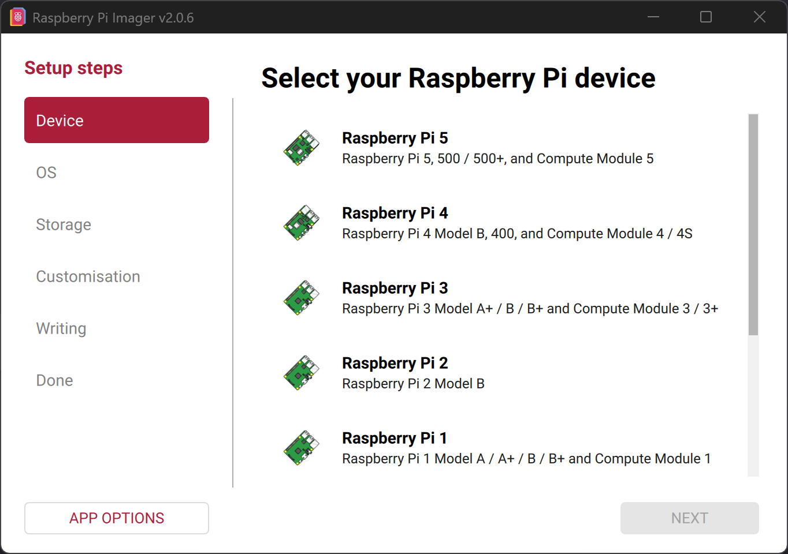
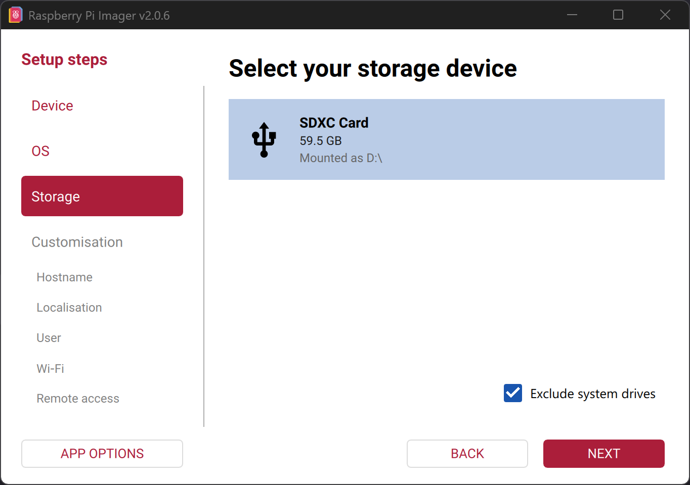
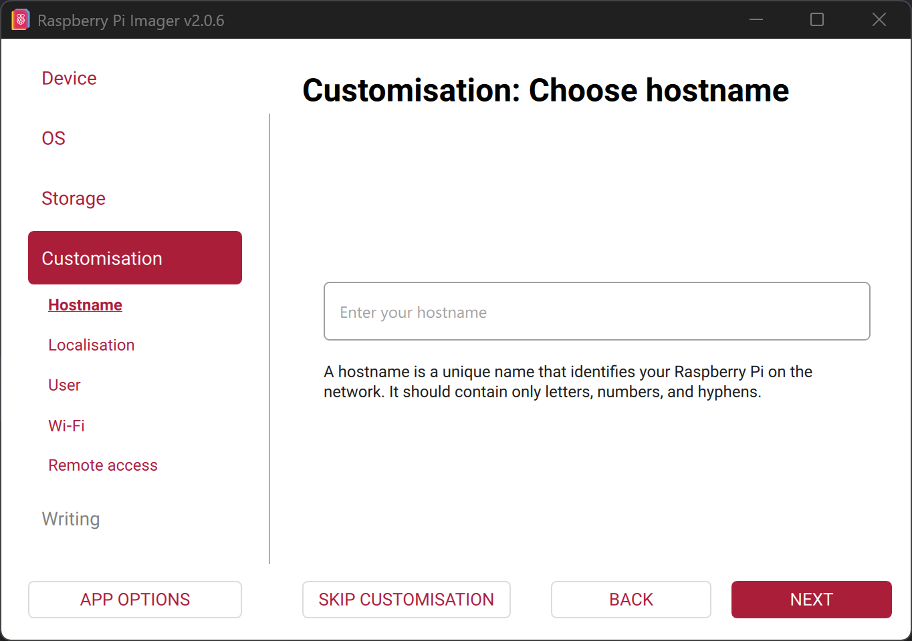
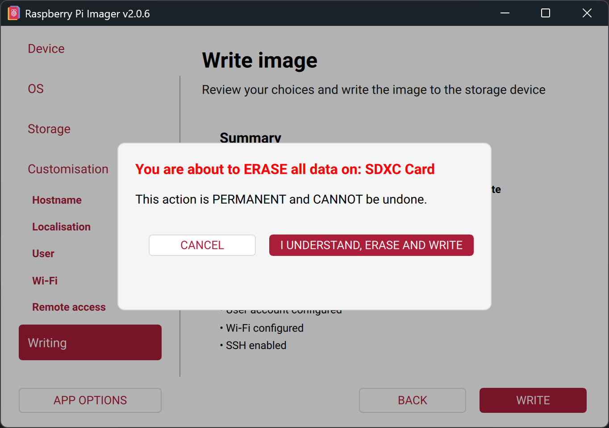

Smartfinch comes as a ready-made SD image: Raspberry Pi OS with Smartfinch and the BirdNET model already installed.
You write it to the microSD card, put the card into the Pi, and the first time you switch it on, the station starts its hotspot with the setup wizard.
The Pi itself does not need internet for this.

## Requirements

You need a computer with internet access, a microSD card (see [Required components](../components/)) and a card reader.

## Download the image

<Steps>

1. Open the page with the latest Smartfinch Pi release on GitHub.

   <LinkCard
     title="Smartfinch Pi – latest release"
     description="Download page with the SD image and the install command."
     href="https://github.com/rajsei/smartfinch-pi/releases/latest"
     isExternal
   />

2. Scroll to the `Assets` section and download the file whose name ends in `-arm64.img.xz`, for example `smartfinch-v0.1.0-arm64.img.xz`.
   The download can take a few minutes. You don't need to unpack the file; Raspberry Pi Imager reads it directly.

</Steps>

## Write the image to the SD card

<Steps>

1. Connect the microSD card to your computer.
   All data on the card will be erased. Back it up first if you still need it.

2. Download Raspberry Pi Imager from [raspberrypi.com/software](https://www.raspberrypi.com/software/), install it and open it.

3. Select your Raspberry Pi model.
   

4. For the operating system, scroll all the way down and choose `Use custom`.
   Then select the downloaded file `smartfinch-…-arm64.img.xz`.

5. Select the SD card.
   Check the name and size carefully, because everything on this drive will be erased in the next step.
   

6. Next, the Imager offers customisation options (hostname, user, Wi-Fi, SSH).
   Smartfinch doesn't need any of them, so you can choose `Skip customisation`.
   The station will then be called `smartfinch-pi` and open its own hotspot on first boot.
   

   When the customisation is still worth it is explained [further below](#optional-customisation-in-the-imager).
   **Outside Germany**, you should at least set your country (see below).

7. Start writing and confirm with `I understand, erase and write`.
   

8. The Imager now writes and verifies the image. Depending on the card, this takes about 5 to 15 minutes.
   As soon as `Write complete!` appears, you can remove the card.

</Steps>

Continue with the [initial setup](../first-setup/).

## Optional customisation in the Imager

The customisation in the Imager is optional. These are the most important cases:

- **Country:** The image is preset for Wi-Fi operation in Germany. If you run the station in another country, for example the USA, enter your country in the customisation.
- **User and SSH:** Create a user and enable SSH if you want to update Smartfinch later.
  Updates are currently installed with a command from the console (see [Install with a command](../install-script/#updating-smartfinch)); there is no update function in the web interface yet.
  Without SSH, the Pi stays on the version you are writing now.
- **Hostname:** If you run several stations in the same network, give each its own name. Smartfinch adopts it as the device name.
  You can also set the name later in the setup wizard.
- **Wi-Fi:** If you enter a Wi-Fi network here, the Pi connects to it directly and doesn't open a hotspot as long as that network is in range.
  You then open the setup wizard from a device on the same Wi-Fi network.
