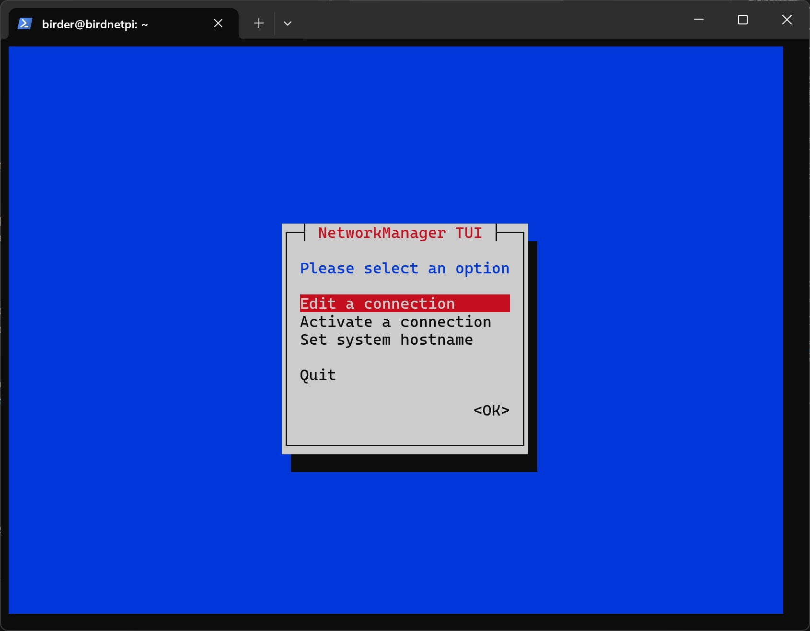
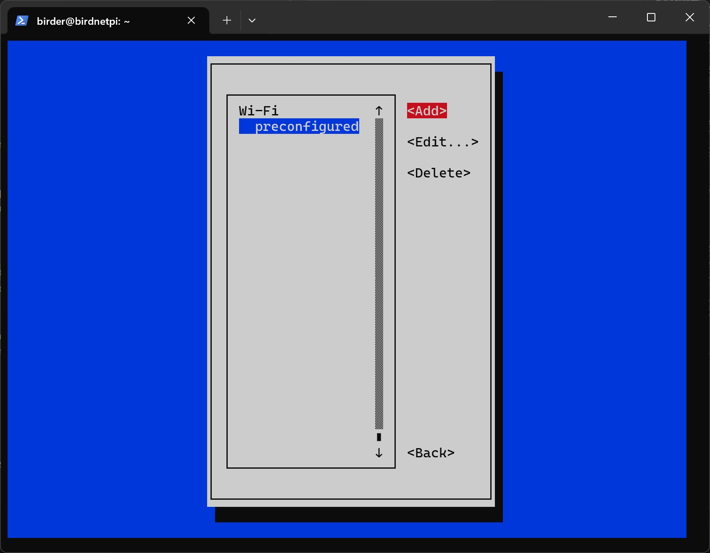
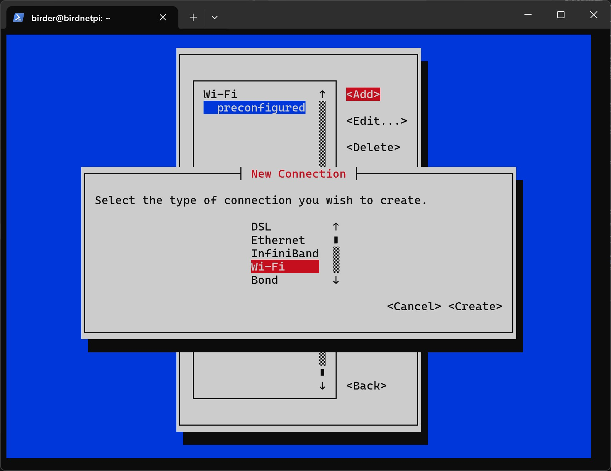
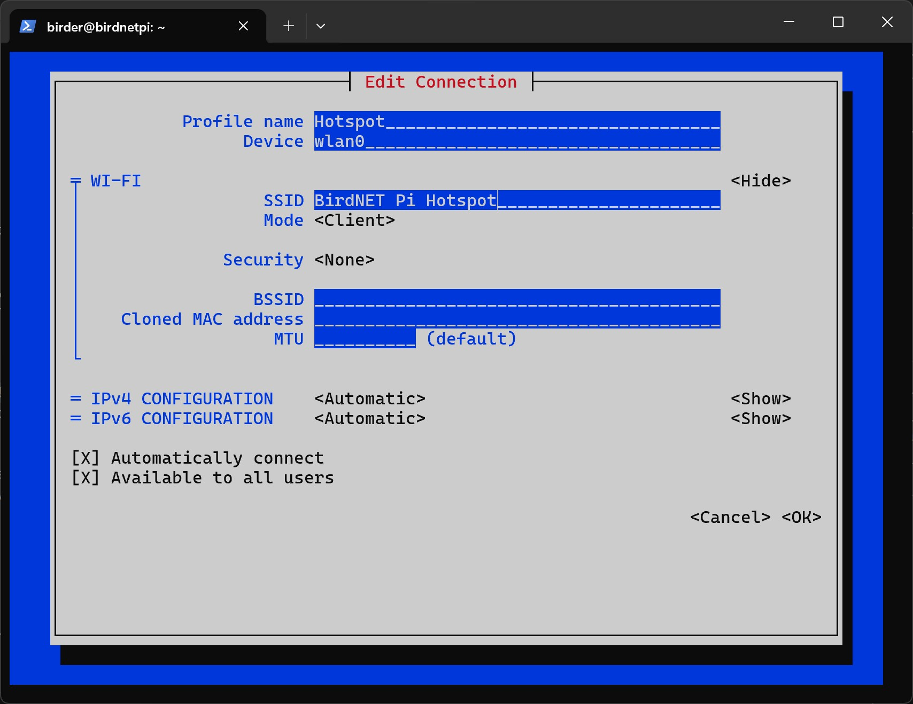
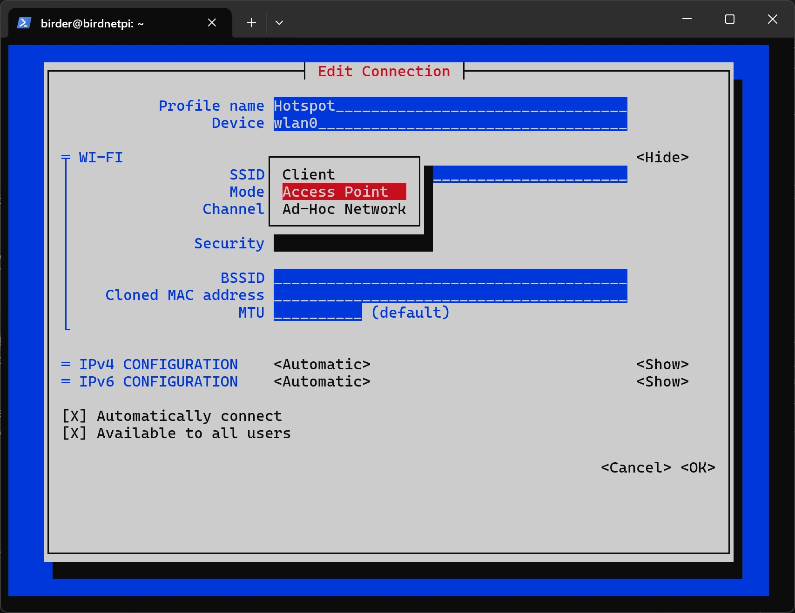
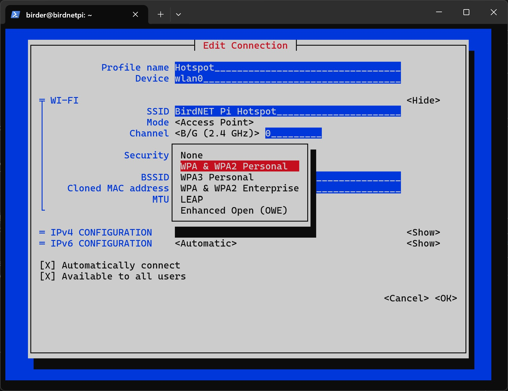
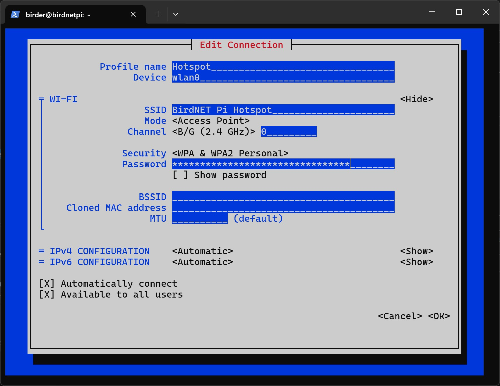
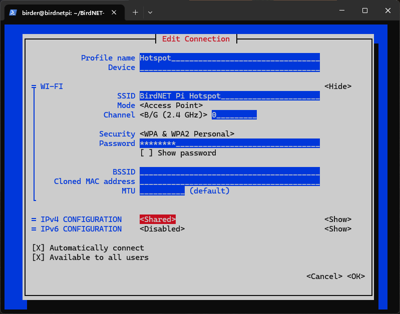
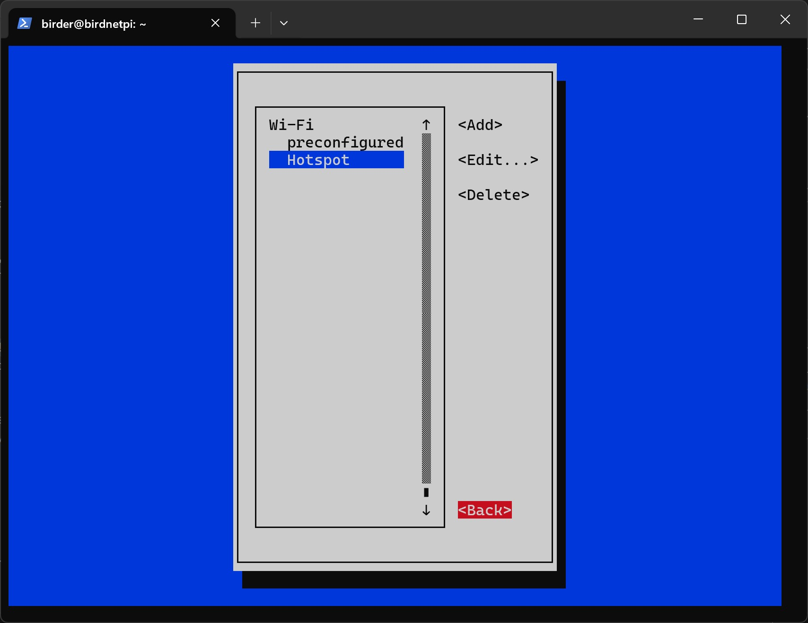
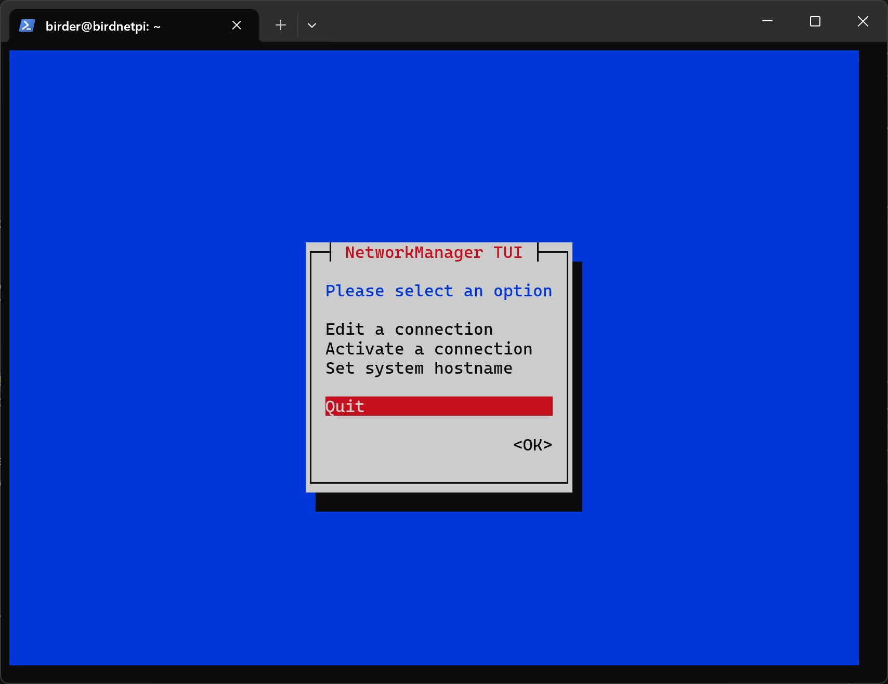

The following instructions explain how to add your **home Wi-Fi** and configure a **fallback hotspot on your BirdNET-Pi**.
This ensures that the system can be accessed both within your local network and in the field.

When the BirdNET-Pi is within range of a configured Wi-Fi network (e.g., your home network), it will automatically connect to it.
If no known network is available, the device will switch to hotspot mode and create its own network.
This hotspot does not provide internet access but allows direct connection to the Raspberry Pi.

## Instructions (Network Manager)

<Steps>

1. If you are no longer connected via SSH, reconnect and enter the **password 'mauersegler'**. **Replace '00' with the number on your Raspberry Pi.**

```sh
ssh birdnet-admin@birdnet-rpi00.local
```

2. First, we need to open the Network Manager:

```sh
sudo nmtui
```



3. In Network Manager, you can move the selected item using the <kbd class="kbd">←</kbd> <kbd class="kbd">↑</kbd> <kbd class="kbd">→</kbd> <kbd class="kbd">↓</kbd> arrow keys and confirm with <kbd class="kbd">Enter ↵</kbd>.

4. Select `Edit a connection`.


5. Select `Add`.



6. Select `Wi-Fi` as the connection type.



7. Select `Create`.


8. Now you need to add your **network configuration**. Let us start with the **hotspot settings**.
   - **Profile Name:** Used for identification only. It is recommended to use the name `Hotspot`, otherwise make sure to **replace `Hotspot` with your chosen name** in the following commands.
   - **Device:** Write `wlan0`. This is the name of the Wi-Fi interface on the Raspberry Pi.
   - **SSID:** This is the **name of the Wi-Fi network** that will be created. You can choose it freely. Since there are many Raspberry Pis in the workshop, make it **unique** so you can easily identify your device. Make sure to **remember it**.



9. Select `Access Point` for `Mode`. (`Client` is for adding a Wi-Fi network, which we will do later.)



10. Select `B/G (2.4 GHz)` for `Channel`.


11. Under `Security`, select `WPA & WPA2 Personal`.



12. Under `Password`, enter a password for the hotspot. **Remember it!** This password will be required to connect to the hotspot later.



13. Configure the **IP settings** as follows: IPv4 Configuration `Shared`, IPv6 Configuration `Disabled`.



14. Select `OK` at the bottom.

15. Optional: Add your home Wi-Fi network by repeating steps 5 to 13. In this case, enter the credentials of your home network — **Profile Name** (recommended: `Home`), **Device** `wlan0`, **SSID** (name of your home Wi-Fi), **Mode** Client (default), **Security** `WPA & WPA2 Personal`, **Password** (of your home Wi-Fi), **IPv4/IPv6 Configuration** `Automatic` (default). This allows the BirdNET-Pi to automatically connect to your home Wi-Fi when it is available.

16. Select `Back`.



17. Select `Quit`.



</Steps>

## Instructions (Set connection priorities)

<Steps>

1. Now we will set the **connection priorities** for the Wi-Fi and hotspot connections. This means that the Raspberry Pi will first attempt to connect to the known Wi-Fi network. Only if no connection is possible will it automatically create its own hotspot so that a connection to the device can still be established. First, we need to navigate to the correct folder using the `cd` command.

```
cd /etc/NetworkManager/system-connections
```

<Code
  lang="plaintext"
  title="Terminal"
  class="terminal-code"
  code="birder@birdnetpi:~ $ cd /etc/NetworkManager/system-connections
  birder@birdnetpi:/etc/NetworkManager/system-connections $"
/>

2. Let's open the file for the **hotspot** connection. (If you chose another profile name for the hotspot, replace `Hotspot` with your chosen name in the following commands.)

```
sudo nano Hotspot.nmconnection
```

<Code
  lang="plaintext"
  title="Terminal"
  class="terminal-code"
  code="  GNU nano 7.2                     Hotspot.nmconnection                               [connection]
id=Hotspot
uuid=4cc09b40-6ef0-4caf-bbf6-600fe2121122
type=wifi

[wifi]
band=bg
mode=ap
ssid=BirdNET Pi Hotspot

[wifi-security]
key-mgmt=wpa-psk
psk=Here is your password for the hotspot

[ipv4]
method=shared

[ipv6]
addr-gen-mode=default
method=disabled

[proxy]

                                  [ Read 23 lines ]

^G Help ^O Write Out ^W Where Is ^K Cut ^T Execute ^C Location
^X Exit ^R Read File ^\ Replace ^U Paste ^J Justify ^/ Go To Line"
/>

3. Insert the following code snippet into the first part of the file. The entry `autoconnect=true` activates automatic connection establishment. The value `autoconnect-priority=0` sets the priority of the network. The higher the number, the more preferred this network is when connecting automatically.

```
autoconnect=true
autoconnect-priority=0
```

<Code
  lang="plaintext"
  title="Terminal"
  class="terminal-code"
  ins={[7,8]}
  code="  GNU nano 7.2                     Hotspot.nmconnection *                             [connection]
id=Hotspot
uuid=4cc09b40-6ef0-4caf-bbf6-600fe2121122
type=wifi
interface-name=wlan0

autoconnect=true
autoconnect-priority=0

[wifi]
band=bg
mode=ap
ssid=BirdNET Pi Hotspot

[wifi-security]
key-mgmt=wpa-psk
psk=Here is your password

[ipv4]
method=auto

[ipv6]
addr-gen-mode=default
method=auto

[proxy]

^G Help ^O Write Out ^W Where Is ^K Cut ^T Execute ^C Location
^X Exit ^R Read File ^\ Replace ^U Paste ^J Justify ^/ Go To Line"
/>

4. Press <kbd class="kbd">Ctrl+S</kbd> and then <kbd class="kbd">Ctrl+X</kbd> to **save and close** the file.

5. Now let's open the file for the **preconfigured Wi-Fi** connection. (This is the workshop Wi-Fi.)

```
sudo nano preconfigured.nmconnection
```

<Code
  lang="plaintext"
  title="Terminal"
  class="terminal-code"
  code='  GNU nano 7.2              preconfigured.nmconnection                  [connection]
id=preconfigured
uuid=fh6c02n6-5th7-4911-9g5c-d356zh245
type=wifi
timestamp=27604593

[wifi]
hidden=true
mode=infrastructure
ssid=Wlan_Name

[wifi-security]
key-mgmt=wpa-psk
psk=4c9ed4tg67fd672c6876d1ec9e1g885a61f4th322be

[ipv4]
method=auto

[ipv6]
addr-gen-mode=default
method=auto

[proxy]

                                  [ Read 23 lines ]

^G Help ^O Write Out ^W Where Is ^K Cut ^T Execute ^C Location
^X Exit ^R Read File ^\ Replace ^U Paste ^J Justify ^/ Go To Line'
/>

6. Insert the following code snippet into the first part of the file.

```
autoconnect=true
autoconnect-priority=10
```

<Code
  lang="plaintext"
  title="Terminal"
  class="terminal-code"
  ins={[7,8]}
  code="  GNU nano 7.2                  preconfigured.nmconnection                            [connection]
id=preconfigured
uuid=fh6c02n6-j705-4911-9g5c-d36127245
type=wifi
timestamp=27604593

autoconnect=true
autoconnect-priority=10

[wifi]
mode=infrastructure
ssid=Wlan_Name

[wifi-security]
key-mgmt=wpa-psk
psk=4c9efd672c68947g4884e4f62744756d1ec9e1g885a61f322be

[ipv4]
method=auto

[ipv6]
addr-gen-mode=default
method=auto

[proxy]

                                  [ Wrote 27 lines ]

^G Help ^O Write Out ^W Where Is ^K Cut ^T Execute ^C Location
^X Exit ^R Read File ^\ Replace ^U Paste ^J Justify ^/ Go To Line"
/>

7. Press <kbd class="kbd">Ctrl+S</kbd> and then <kbd class="kbd">Ctrl+X</kbd> to **save and close** the file.

8. **Optional:** If you configured your **home Wi-Fi** network, open the file for the 'Home' Wi-Fi connection. If you didn't, skip to the last step. (If you chose another profile name for the Wi-Fi network, replace `Home` with your chosen name in the following command.)

```
sudo nano Home.nmconnection
```

<Code
  lang="plaintext"
  title="Terminal"
  class="terminal-code"
  code='  GNU nano 7.2              Home.nmconnection                  [connection]
id=Home
uuid=fh6c02n6-5th7-4911-9g5c-d356zh245
type=wifi
timestamp=27604593

[wifi]
mode=infrastructure
ssid=Wlan_Name

[wifi-security]
key-mgmt=wpa-psk
psk=4c9ed4tg67fd672c6876d1ec9e1g885a61f4th322be

[ipv4]
method=auto

[ipv6]
addr-gen-mode=default
method=auto

[proxy]

                                  [ Read 23 lines ]

^G Help ^O Write Out ^W Where Is ^K Cut ^T Execute ^C Location
^X Exit ^R Read File ^\ Replace ^U Paste ^J Justify ^/ Go To Line'
/>

9. Insert the following code snippet into the first part of the file.

```
autoconnect=true
autoconnect-priority=9
```

<Code
  lang="plaintext"
  title="Terminal"
  class="terminal-code"
  ins={[7,8]}
  code="  GNU nano 7.2                  Home.nmconnection                            [connection]
id=Home
uuid=fh6c02n6-j705-4911-9g5c-d36127245
type=wifi
timestamp=27604593

autoconnect=true
autoconnect-priority=9

[wifi]
hidden=true
mode=infrastructure
ssid=Wlan_Name

[wifi-security]
key-mgmt=wpa-psk
psk=4c9efd672c68947g4884e4f62744756d1ec9e1g885a61f322be

[ipv4]
method=auto

[ipv6]
addr-gen-mode=default
method=auto

[proxy]

                                  [ Wrote 27 lines ]

^G Help ^O Write Out ^W Where Is ^K Cut ^T Execute ^C Location
^X Exit ^R Read File ^\ Replace ^U Paste ^J Justify ^/ Go To Line"
/>

10. Press <kbd class="kbd">Ctrl+S</kbd> and then <kbd class="kbd">Ctrl+X</kbd> to **save and close** the file.

11. Now **restart** the Raspberry Pi.

```sh
sudo reboot
```

</Steps>
