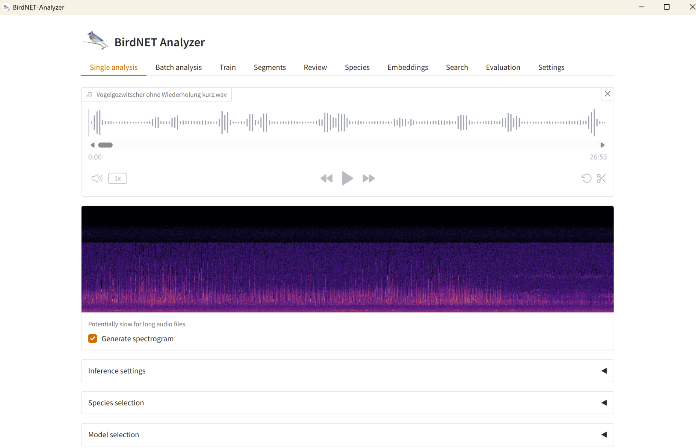
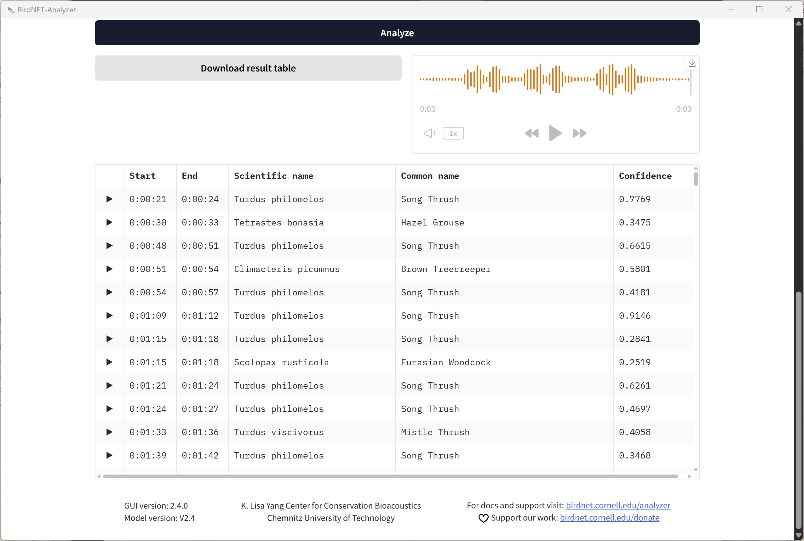

In addition to the BirdNET-Pi, we also have other tools, such as the BirdNET-Analyzer.

If we have enough time, we will work with real-world bird sound recordings collected in advance using AudioMoth devices.
The AudioMoth is a compact, low-power acoustic recorder that is widely used in ecological and bioacoustic research to capture environmental sounds over extended periods of time.

These recordings will be analyzed using the BirdNET-Analyzer, a tool developed to automatically detect and classify bird species from audio data.

Steps:

<Steps>

1. Download and set up the [BirdNET-Analyzer](https://github.com/birdnet-team/BirdNET-Analyzer/releases/tag/v2.4.0) from the GitHub repository.

2. Upload the pre-recorded audio files from the AudioMoth devices to the BirdNET-Analyzer.

   - Note: We will only analyze some parts of the audio files, as analyzing the entire recordings would be too time-consuming.
   - If the file is too long, deselect the option `Generate spectrogram`.

   

3. Run automated species detection.

4. Explore the results, including timestamps, confidence scores, and predicted species.

   

</Steps>

This hands-on session provides practical insight into how bioacoustic data is processed and analyzed using AI, and demonstrates how such tools can support research, monitoring, and conservation efforts.
